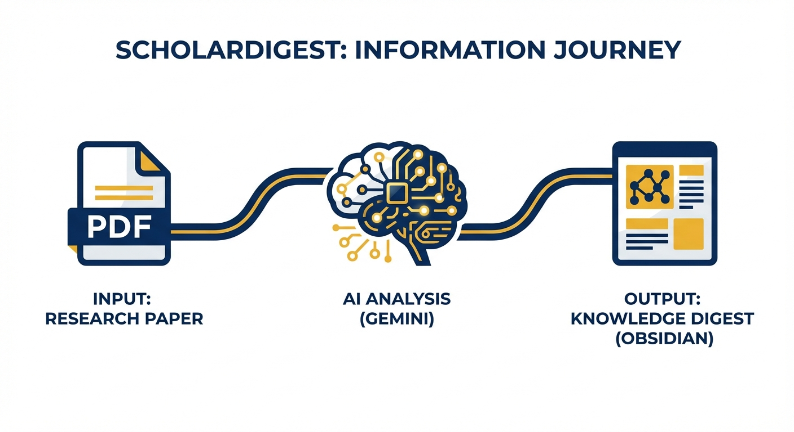

<div align="center">

</div>

# ScholarDigest

**Turn Papers into Knowledge.**

ScholarDigest is an AI-powered research paper analyzer that automatically generates structured digests using specific Obsidian-style templates. It leverages Google's **Gemini** models (defaulting to `gemini-3.8-flash` with automatic fallback) to extract key methods, results, and citations from PDF research papers directly into your preferred format.

## Features

- **📄 AI-Powered Analysis**: Instantly extracts insights, methods, and results from PDF research papers using `gemini-3.8-flash` by default, with an in-app model selector and automatic fallback (`gemini-3.8-flash` → `gemini-3.5-flash-lite` → `gemini-3.1-flash-lite`).
- **🌐 Multi-language Support**: Generate digests in **English** or **Chinese**. Perfect for bilingual researchers and cross-language knowledge management.
- **📝 Customizable Templates**: Flexible Markdown template system. Create, edit, delete, and manage custom templates directly on disk to match your Obsidian vault or personal note-taking style.
- **🎨 Modern & Responsive**: A clean interface built with React 19, Vite 8, and locally bundled Tailwind CSS v4 + Typography for crisp Markdown rendering.
- **🔗 Obsidian Ready**: Designed to produce output that pastes perfectly into Obsidian, including WikiLink support (e.g., `[[MethodName]]`).
- **🔒 Secure**: Your API key stays strictly on the local server middleware (`/api/digest`) and is never bundled into or exposed to the browser.

## Tech Stack

- **Frontend**: React 19, TypeScript, Vite 8
- **Styling**: Tailwind CSS v4 + `@tailwindcss/typography` (locally compiled via `@tailwindcss/vite`)
- **AI Model (Web App & CLI)**: Google Gemini API (`@google/genai` v3), defaulting to `gemini-3.8-flash` with `thinkingLevel: MEDIUM` and automatic fallback chain (`gemini-3.5-flash-lite` → `gemini-3.1-flash-lite`)


## Security & Secrets

To keep your personal information and API keys safe:
- **Never commit secrets**: Real API keys should be placed in `.env.local`.
- **Use the template**: Refer to `.env.example` for the required environment variables.
- **Git Ignore**: The `.gitignore` is configured to block all `.env` files from being tracked.

## Getting Started

### Prerequisites

- **Node.js**: **v22+** (required by `@google/genai` v3)
- **Gemini API Key**: Get one from [Google AI Studio](https://aistudio.google.com/).

### Installation & Setup

1. **Install dependencies**:
   ```bash
   npm install
   ```

2. **Configure Environment**:
   Create a `.env.local` file in the root directory and add your Gemini API key:
   ```env
   GEMINI_API_KEY=your_actual_api_key_here
   ```

3. **Run the App**:
   
   **Development Mode:**
   ```bash
   npm run dev
   ```

   **Background Mode (using PM2):**
   To keep the app running in the background on your server:
   ```bash
   pm2 start npm --name "scholardigest" -- run dev
   ```
   
   Open your browser to `http://localhost:3001` (or `http://<server-ip>:3001` for remote access on your trusted LAN/VPN — AI requests are proxied through the local server, so remote browsers do not need an API key or separate proxy setup).

## Batch Processing (CLI)

You can batch analyze multiple papers at once using the command line.

1.  Place your PDF files in the `input/` folder.
2.  Run the batch command:
    ```bash
    npm run batch
    ```

    **CLI Options:**
    - `--template=<name>`: Template name without `.md` (default: `general_article`)
    - `--lang=<en|cn>`: Output language (default: `en`)
    - `--model=<modelId>`: Primary Gemini model (default: `gemini-3.8-flash`, with automatic fallback)
    - `--force`: Re-process files even if output `.md` already exists (by default existing outputs are skipped for resume support)
    - `--delay=<ms>`: Delay between API calls in milliseconds (default: `5000`)

    ```bash
    npm run batch -- --template=brief --lang=cn
    npm run batch -- --template=methods --lang=en --model=gemini-3.8-flash
    npm run batch -- --force --delay=3000
    ```

### Proxy Support

If you are behind a proxy, both the local web server (`/api/digest`) and the CLI tool will automatically detect and use it. You can set the proxy in your `.env.local` or your terminal:
```env
# In .env.local
HTTPS_PROXY=http://127.0.0.1:7890
```

3.  Find the generated Markdown digests in the `output/` folder.

    *Note: Large PDFs (>14 MB) automatically upload via the Gemini Files API, transient errors retry with backoff, and model unavailability automatically falls back to `gemini-3.5-flash-lite` / `gemini-3.1-flash-lite`.*


## Updates

### 2026-11-22
- **Security & Architecture**: Moved Gemini API calls from the browser to local Vite server middleware (`POST /api/digest` in `server/apiPlugin.ts`), eliminating `GEMINI_API_KEY` exposure from client bundles and enabling server-side proxy support.
- **Model Upgrade & Automatic Fallback**: Upgraded `@google/genai` to v3 (`^3.6.1`), switched default model to `gemini-3.8-flash` with `thinkingConfig.thinkingLevel = MEDIUM`, added an in-app & CLI model selector (`--model=`), and implemented automatic model fallback (`gemini-3.8-flash` → `gemini-3.5-flash-lite` → `gemini-3.1-flash-lite`) plus retry logic and Gemini Files API support for large PDFs.
- **Core Bug Fixes**: Added `DELETE /api/templates/:id` and `DELETE /api/history/:id` endpoints, enforced server-side protection for built-in system templates, fixed custom template saving & display naming, expanded history retention to 20 items, used original PDF filenames when downloading digests, and fixed CLI error reporting with resume support (`--force`, `--delay`).
- **Frontend & Tooling**: Upgraded to Vite 8 (`^8.3.8`) and React 19.3, migrated from Tailwind CDN to locally compiled Tailwind CSS v4 + `@tailwindcss/typography` (fixing Markdown `prose` rendering), removed legacy `importmap` and unused files, and untracked `temp/history.json`.

### 2026-07-03
- **External Summary Templates**: Fully externalized built-in summary templates (`standard`, `brief`, `methods`). The web app now dynamically loads all templates from the server via `/api/templates`, leaving no hardcoded template contents in the client-side bundle.
- **Default Template**: Designated `general_article` (General_article) as the default summary template across the entire system—both in the web client and the batch processing CLI script.
- **Template Protection**: Updated Vite server middleware to mark all pre-shipped templates (`general_article`, `review`, `aivc_paper`, `scp_paper`, `standard`, `brief`, `methods`) as default system templates, protecting them from accidental edit or deletion in the UI.

### 2026-01-20
- **Task History**: Added persistent history feature. Recent digests are now automatically saved to `temp/history.json` and accessible from the UI, even after a restart.
- **Template System**: Enhanced template management. Custom templates created in the UI are now saved directly to the `templates/` directory as Markdown files.
- **Model Upgrade**: Updated the web app to use `gemini-3.1-flash-lite` with `thinkingConfig` enabled for deeper reasoning and more accurate extraction.
- **Server Middleware**: Implemented custom Vite middleware to handle local file system operations (history and templates) directly from the frontend dev server.

### 2026-01-18
- **Language Selection**: Implemented dual-language support (English and Chinese) for both the web UI and batch processing script.
- **Core Improvements**: Extracted default templates to external Markdown files in `templates/` and implemented file system sync for new web UI templates.
- **CLI Enhancements**: Added Batch Processing CLI tool (`npm run batch`) with template selection, proxy support, and `gemini-3.1-flash-lite` stability.
- **UI & UX**: Added loading progress bars (Web & CLI), improved template visibility, and implemented a robust fallback for the "Copy Markdown" feature.
- **Security & Ops**: Implemented secure secret management (`.env.example`), moved agent rules to `.gemini/`, and documented `pm2` deployment.
- **Agent Config**: Added `GEMINI.md` for interaction customization.
- **Visuals**: Designed and implemented a new "Nature-level" scientific infographic banner (`cover.jpeg`).
